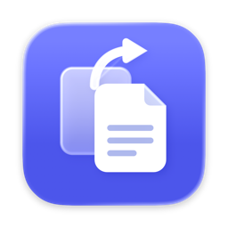
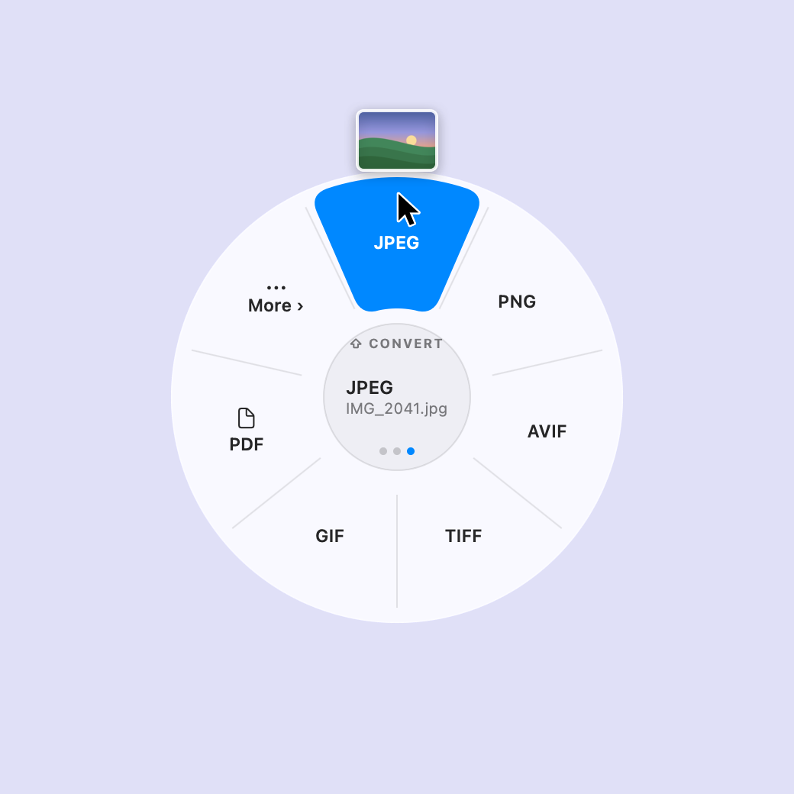
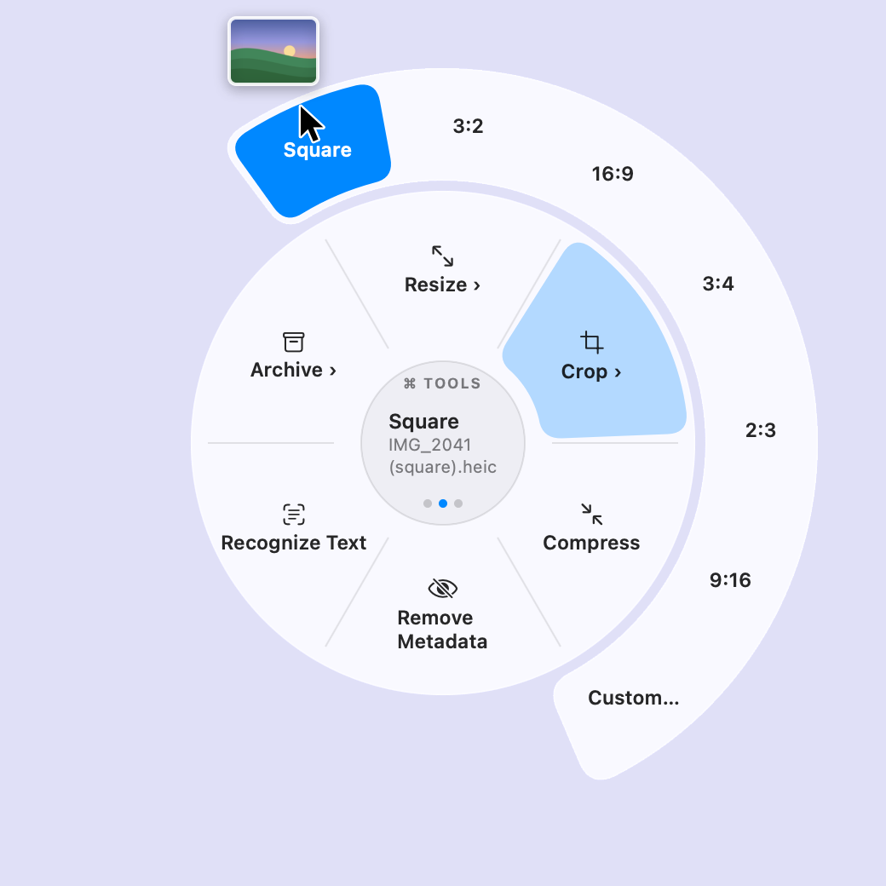
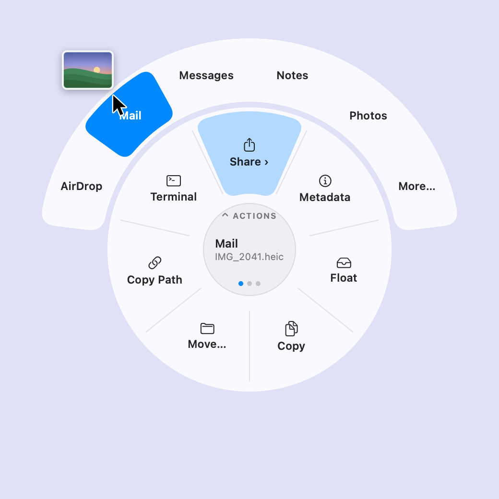
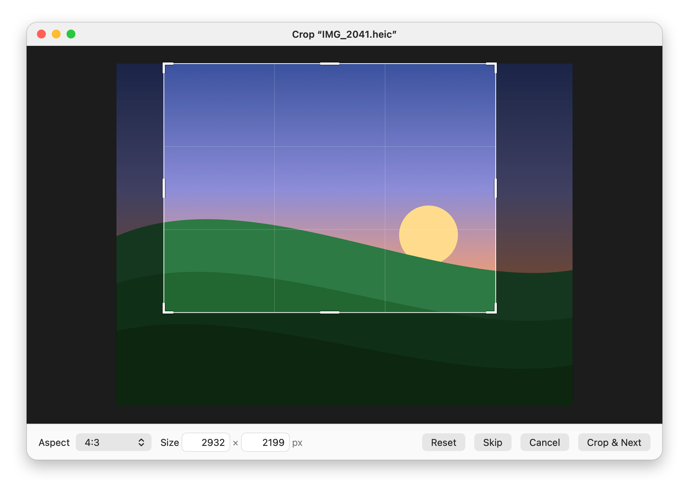
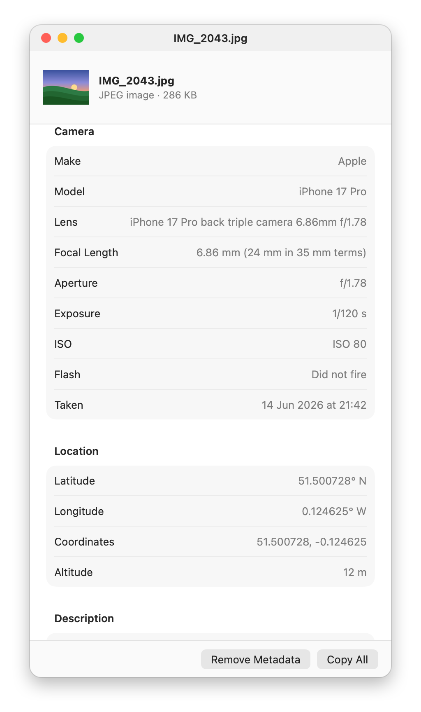
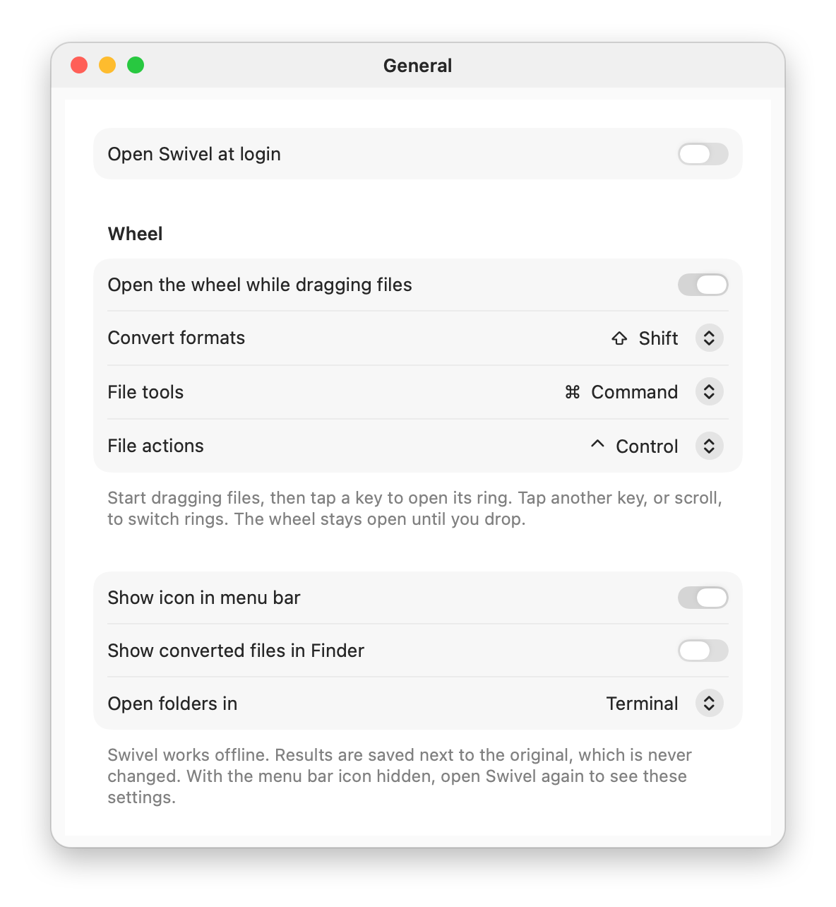

<div align="center">



# Swivel

**Drag a file, tap a key, drop it on the wheel.**<br>
Convert, crop, compress, inspect and share files on your Mac without uploading them anywhere.

[](https://github.com/jonathanlotan/Swivel/releases/latest/download/Swivel.dmg)

```bash
brew install --cask jonathanlotan/tap/swivel
```

[](https://github.com/jonathanlotan/Swivel/releases/latest)
[](#faq)
[](#faq)
[](#private-by-design)
[](LICENSE)
[](https://github.com/jonathanlotan/Swivel/actions/workflows/ci.yml)

English · [简体中文](README.zh-CN.md)

### [▶ Try the wheel in your browser](https://jonathanlotan.github.io/Swivel/)

<picture>
  <source media="(prefers-color-scheme: dark)" srcset="docs/images/wheel-demo.dark.gif">
  
</picture>

</div>

## Why Swivel

- **Free and open source.** MIT licensed. No trial, no account, no in-app purchase.
- **Nothing to allow.** The wheel works without Accessibility or Input Monitoring permission ([how](#how-it-works)).
- **Never touches the network.** There's no network code, and a test fails if networking APIs get linked in.
- **Small and native.** Swift and Apple's own frameworks, signed and notarized by Apple.
- **Works with Shortcuts.** A Convert File action, plus Convert to JPEG, Compress and Convert to PDF ready-made, in Spotlight too.
- **A command line too.** The same engine as `swivel convert --to image.jpeg *.heic`, installed with the app.

## One gesture, three rings

Start dragging files anywhere, in Finder or on the desktop, and **tap** a key.
The wheel opens at the pointer. Drop on a slice to run it, or in the middle to
cancel. Slices marked › open a second ring when you rest on them.

<table>
  <tr>
    <th align="center"><kbd>⇧</kbd> Shift: <b>Convert</b></th>
    <th align="center"><kbd>⌘</kbd> Command: <b>Tools</b></th>
    <th align="center"><kbd>⌃</kbd> Control: <b>Actions</b></th>
  </tr>
  <tr>
    <td>
      <picture>
        <source media="(prefers-color-scheme: dark)" srcset="docs/images/wheel-convert.dark.png">
        
      </picture>
    </td>
    <td>
      <picture>
        <source media="(prefers-color-scheme: dark)" srcset="docs/images/wheel-tools.dark.png">
        
      </picture>
    </td>
    <td>
      <picture>
        <source media="(prefers-color-scheme: dark)" srcset="docs/images/wheel-actions.dark.png">
        
      </picture>
    </td>
  </tr>
  <tr>
    <td valign="top">The formats these files can become: images, video, audio, documents and PDFs. Less common ones are under More.</td>
    <td valign="top">Resize, crop, rotate, fit to a size, compress, remove backgrounds or metadata, recognize text, merge or split PDFs, make archives.</td>
    <td valign="top">Share (AirDrop, Mail, Messages, Notes, Photos, or any app), see metadata, float on a shelf, copy, move, copy the path, open in Terminal.</td>
  </tr>
</table>

- **Scroll** to switch rings. Up goes to the next one, in the order Actions, Tools, Convert. Tapping another key works too.
- **Results go next to the original**, named the way Finder would: `IMG_2041.jpg`, `IMG_2041 2.jpg`, `IMG_2041 (square).heic`. Nothing is ever overwritten, and the original is never changed.
- **The keys are yours to choose** in Settings. Keys already held when a drag starts don't count, so ordinary drags behave as before.

## Crop and metadata

<picture>
  <source media="(prefers-color-scheme: dark)" srcset="docs/images/crop-editor.dark.png">
  
</picture>

**Crop** has Square, 4:3, 3:2, 16:9, 3:4, 2:3 and 9:16 straight from the wheel, cut from the
middle. **Custom…** opens the editor above: drag the handles, pick a shape, or type an exact
size and the crop is scaled to it. With several photos it steps through them, keeping the shape.

<table>
  <tr>
    <td width="50%" valign="top">
      <picture>
        <source media="(prefers-color-scheme: dark)" srcset="docs/images/metadata.dark.png">
        
      </picture>
    </td>
    <td width="50%" valign="top">
      <picture>
        <source media="(prefers-color-scheme: dark)" srcset="docs/images/settings.dark.png">
        
      </picture>
    </td>
  </tr>
  <tr>
    <td valign="top"><b>Metadata</b> shows what a file says about itself: camera, lens, exposure and location for photos; tracks and codecs for audio and video; pages and author for PDFs. <b>Remove Metadata</b> saves a clean copy of a photo, video or PDF.</td>
    <td valign="top"><b>Settings</b>: the keys for each ring, image and video quality, favourite formats, launch at login, and whether the menu bar icon shows.</td>
  </tr>
</table>

## What it handles

<details>
<summary><b>Images</b>: JPEG, PNG, HEIC, AVIF, TIFF, GIF, PDF and more</summary>

- Write: JPEG, PNG, HEIC, AVIF, TIFF, GIF, PDF, BMP, JPEG 2000, ICNS, ICO, PSD, TGA.
- Also read: WebP, EXR and SVG. JPEG XL and camera RAW should open too, through macOS, but aren't tested.
- Animated GIFs can become MP4 or MOV.
- Tools: resize, crop, rotate and flip, fit under 1, 5, 8 or 25 MB, compress, remove the
  background (macOS 14 or later), remove metadata, recognize text, combine into a PDF.
- Fit to Size lowers the quality first, then the pixel size, and saves nothing rather than a
  result too small or blurry to use.
- Photos stay upright, and their metadata is kept unless you turn that off.
</details>

<details>
<summary><b>Video and audio</b>: MP4, MOV, ProRes, GIF, M4A, WAV, FLAC…</summary>

- Video: MP4 (H.264 or HEVC), MOV, MOV (ProRes), M4V, GIF, or a still frame.
- The sound from a video: M4A, WAV, AIFF or FLAC.
- Audio: M4A (AAC or lossless), WAV, AIFF, FLAC, AAC, CAF. 24-bit stays 24-bit.
- Video tools: compress, resize to 4K, 1080p, 720p or 540p (only sizes smaller than the clip), remove audio,
  remove metadata (location, date, camera and title, without re-encoding).
- Audio tools: compress to a smaller AAC file (offered for lossless audio and anything above the chosen rate).
</details>

<details>
<summary><b>Documents and PDFs</b>: Word, RTF, HTML, text, PDF</summary>

- Between plain text, RTF, HTML, Word (.docx and .doc) and OpenDocument, and any of them to PDF.
- PDF to text, or to PNG, JPEG, HEIC or TIFF pages.
- Merge, split and compress PDFs, remove their metadata (title, author, keywords), and recognize text in scans.
</details>

<details>
<summary><b>Archives</b>: ZIP, TAR.GZ, TAR.XZ, 7Z, Apple Archive</summary>

- Make an archive of any files or folders, extract one, or convert between formats.
- Extracting never writes outside its own folder.
</details>

Formats that would need third-party encoders (writing WebP or JPEG XL, MP3, Ogg, WebM, MKV)
aren't included.

**Other ways in:** drop files on the menu bar icon, choose **Convert Files…** from its menu,
use **Services › Convert with Swivel…** or the Quick Action in Finder, or **Open With**.

- **Shortcuts:** the **Convert File** action takes files and a conversion (JPEG, Resize › 1920 px,
  Crop › Square…) and returns the results, so a folder automation or a Quick Action can convert
  without the wheel. **Convert to JPEG**, **Compress** and **Convert to PDF** come ready-made, in
  Spotlight too: "Compress with Swivel".

### The command line

The app includes `swivel`, the same engine without the wheel. Homebrew puts it on your `PATH`;
otherwise it's at `Swivel.app/Contents/Helpers/swivel`.

```bash
swivel list IMG_2041.heic                  # what this file can become
swivel convert --to image.jpeg *.heic      # results go next to each original
swivel formats                             # every conversion and whether this Mac can do it
```

## Private by design

Everything happens on your Mac, with Apple's own frameworks (ImageIO, AVFoundation,
AudioToolbox, PDFKit, Vision) and tools that come with macOS (`textutil`, `ditto`, `tar`,
`aa`). There's no network code, no account and no telemetry; a test checks that no
networking APIs are linked. Locations in the metadata window are shown as coordinates,
with no map, because a map would need the network. See the [privacy policy](https://jonathanlotan.github.io/Swivel/privacy.html).

## How it works

- **Spotting a drag without permissions.** Any app may watch for mouse-downs in other apps,
  and read the drag pasteboard's change count and types (never its contents). Swivel arms on
  mouse-down, checks 60 times a second while the button is held, and treats it as a file drag
  only when the drag pasteboard changed and holds file URLs. Then a tap of a ring key opens the
  wheel, a non-activating panel that takes the drop. Watching key presses in other apps would
  need Accessibility or Input Monitoring; reading which modifier keys are down doesn't.
- **Nothing overwritten, nothing half-written.** Each result is written to a temporary folder,
  then moved into place with `renamex_np(…, RENAME_EXCL)`, which fails rather than replace a
  file, so the name steps on to `IMG_2041 2.jpg`. A cancelled or failed job leaves nothing behind.
- **Archives stay in their folder.** Extraction refuses any entry that would land outside it.
- **Offline, checked.** Tests run `nm -u` on the built app, Quick Action and CLI, and fail on
  `URLSession`, CFNetwork, sockets or `getaddrinfo`. The Quick Action has no network entitlement.
- **These pictures are the app.** The images on this page are rendered from the app's own views
  by a test (`make readme-images`), so they can't drift from what ships.

## FAQ

<details>
<summary><b>Why can't it write WebP, MP3, WebM or MKV?</b></summary>

macOS has no encoders for them, and Swivel only uses what comes with macOS. It can read WebP.
Writing these would mean bundling libwebp, LAME or ffmpeg, each with its own license and size;
they may come later as an optional add-on.
</details>

<details>
<summary><b>Which Macs and macOS versions?</b></summary>

Apple silicon Macs with macOS 13 Ventura or later. It's tested on macOS 26, and the conversion
engine's tests also run on macOS 15 for every change. Reports from other versions are welcome in [Issues](https://github.com/jonathanlotan/Swivel/issues).
</details>

<details>
<summary><b>How do I update it?</b></summary>

Swivel never checks for updates, since that would need the network. Use
`brew upgrade --cask swivel`, or watch this repository for releases (**Watch › Custom › Releases**).
</details>

<details>
<summary><b>How is this different from Tangerine?</b></summary>

The Shift-drag idea comes from [Tangerine](https://tangerineformac.com) by Leap Studio, a paid
app with more formats and tools. If you want a commercially supported converter, buy it.
Swivel is an independent, open-source take on the idea, built from Tangerine's public
description. None of its code or assets are used.
</details>

<details>
<summary><b>How do I uninstall it?</b></summary>

Quit it from the menu bar and move Swivel.app to the Trash (or `brew uninstall --cask swivel`).
Its settings are in `~/Library/Preferences/io.github.jonathanlotan.Swivel.plist`.
</details>

## Building

You need Xcode 26 or later (built and tested with Xcode 27.1) and
[XcodeGen](https://github.com/yonaskolb/XcodeGen) (`brew install xcodegen`).

```bash
make run
```

| Command | What it does |
|---|---|
| `make run` | Builds and opens the app (it lives in the menu bar) |
| `make test` | Runs all tests: 65 for the conversion engine, 104 for the app |
| `make app` | Generates the Xcode project and builds the app |
| `make core-test` | Runs only the conversion engine's tests |
| `make cli` | Builds the `swivel` command and prints its path |
| `make readme-images` | Renders the pictures on this page from the app's own views |
| `make release` | Signs, notarizes and packages `Swivel.dmg` ([how](docs/dev/releasing.md)) |
| `make clean` | Removes the build output |

Builds go to `~/Library/Caches/Converter` rather than the project folder, because iCloud
Drive's file attributes break code signing. Local builds are signed to run on your own Mac
(ad hoc).

## Project layout

- `Packages/ConverterCore`: the conversion engine, a Swift package with no UI code, plus the `swivel` command and its tests.
- `Converter/App`: the menu bar app in SwiftUI and AppKit: the wheel, menus, job queue, settings, crop editor, metadata window, welcome window and file actions.
- `Converter/QuickAction`: the Finder Quick Action extension.
- `Converter/AppTests`: the app's tests, including the renderer for this page's pictures.
- `docs/`: the [browser tryout](docs/index.html) and, in [`docs/dev`](docs/dev), the development [plan](docs/dev/plan.md), the [verification report](docs/dev/verification.md) and the [design notes](docs/dev/design.md) for macOS 26 and 27.

## Contributing

Bug reports, format requests and pull requests are welcome; see [CONTRIBUTING.md](CONTRIBUTING.md).

## Credits

Made by Jonathan Lotan, with help from [Claude Code](https://claude.com/claude-code).
The Shift-drag gesture is inspired by [Tangerine](https://tangerineformac.com).

If Swivel saves you a trip to a converter website, a ⭐ helps other people find it.
